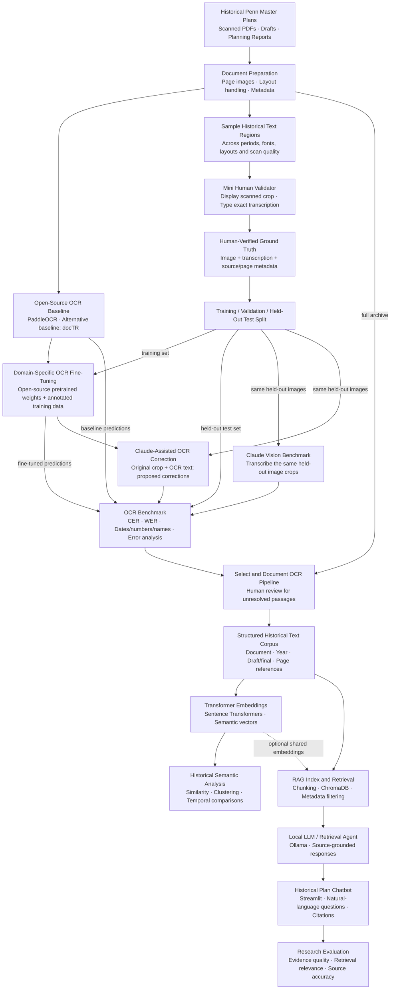

# Vision for Final Project

**Historical Campus Planning Archive: Semantic Analysis and AI-Assisted Exploration**  
**Zhanchao Yang**

## Project Overview

This project aims to develop an AI-assisted framework for analyzing and exploring the University of Pennsylvania's historical campus master plans. The archive includes published master plans, preliminary drafts, and related historical planning reports. The project will investigate how Penn's planning priorities, institutional objectives, and approaches to campus development evolved over time.

The project has two connected parts. **Part 1** converts historical scanned archives into reliable machine-readable text, evaluates optical character recognition (OCR) with a human-created benchmark, and applies transformer-based semantic analysis. **Part 2** builds a lightweight, document-grounded AI research assistant that allows users to query and compare historical plans in natural language.

The final product will include a documented historical text corpus, a reproducible OCR benchmark, semantic analysis results, and an interactive local chatbot with citations to archival sources.

## Complete Project Framework

*The human-verified test set remains separate from OCR fine-tuning and model selection. Claude's outputs are evaluated against human transcriptions; they are not treated as ground truth. The full archive is transcribed using the selected OCR workflow, while the benchmark uses a representative annotated subset.*

## Part 1: Semantic Analysis of Penn's Historical Campus Master Plans

### 1.1 Historical Archive Digitization and Text Preparation

The first stage will assemble Penn's historical campus planning documents, including official master plans, preliminary drafts, and related planning reports. Because many documents survive as scanned PDFs, the project will convert page images into machine-readable text.

Page preprocessing may include image rotation, deskewing, contrast adjustment, and layout segmentation as needed. The project will preserve the connection between each extracted passage and its original source, including document title, publication year, draft or final status, and page number. Tables, diagrams, maps, and low-legibility pages will be flagged for special handling rather than silently converted into unsupported text.

The output will be an organized archive containing page images, OCR transcriptions, quality indicators, and archival metadata.

### 1.2 Open-Source OCR Model and Domain-Specific Fine-Tuning

The primary OCR approach will use a dedicated pretrained open-source model, initially **PaddleOCR**. **docTR** may serve as a comparison baseline. Model version, license, training configuration, and inference settings will be documented before implementation.

Historical planning documents vary in font, printing quality, scan resolution, and layout. The project will therefore test whether fine-tuning the recognition component of an open-source OCR model on a small set of manually transcribed historical samples improves accuracy relative to its pretrained baseline. Training a new foundation model or using a high-end general-purpose LLM as the primary OCR engine is outside the project's scope.

Fine-tuning will be treated as an empirical experiment, not an assumed improvement. If a baseline model performs as well as or better than its fine-tuned version on held-out documents, the baseline will remain a valid choice for full-corpus digitization.

### 1.3 Mini Human Validator and Ground-Truth Construction

A lightweight local application, built with **Streamlit**, will support manual transcription of historical source material. The interface will display one cropped paragraph or text region from an original scanned page, alongside a blank transcription box. The annotator will type exactly what appears in the image and save the result with a sample identifier and archival metadata.

The human transcription interface will hide model predictions to avoid anchoring the annotator to OCR outputs. Unclear characters, illegible text, and uncertain transcriptions will be flagged for review. A subset can be transcribed twice or rechecked to detect human errors.

Samples will be selected across different documents, historical periods, font and layout types, and scan-quality levels. The resulting dataset will be divided into **training**, **validation**, and **held-out test** partitions. To reduce leakage, document- or page-level separation will be prioritized over random splitting of adjacent paragraphs from the same page.

These verified human transcriptions—not Claude-generated text—will provide the ground-truth reference for OCR benchmarking.

### 1.4 OCR Benchmark and Claude-Assisted Validation

The project will compare four OCR configurations on the same held-out historical image samples:

| Configuration | Input | Purpose |
|---|---|---|
| Pretrained PaddleOCR | Original text-region image | Open-source baseline |
| Fine-tuned PaddleOCR | Same text-region image | Measure gains from historical-domain adaptation |
| Claude Vision, direct transcription | Same text-region image | Compare a capable multimodal model against OCR models |
| PaddleOCR + Claude review/correction | Original image and PaddleOCR transcription | Test whether AI-assisted correction reduces transcription errors |

The central performance measures will be **Character Error Rate (CER)** and **Word Error Rate (WER)**, calculated against manually verified ground-truth text. Secondary measures will examine exact matches for dates, numerical quantities (for example, parking-space counts), institutional names, and place names. OCR errors that affect historical interpretation will be documented separately.

Claude will play two distinct roles: an **independent transcription benchmark** when given the image alone, and an **assisted reviewer** when given both an image and another model's OCR output. It will not determine the correct text merely by asserting that a transcription is accurate. Candidate corrections will be checked against the page images, and the held-out test set will not be used to fine-tune the OCR model.

The experiment will report both improvements and failures. It will also consider processing cost, speed, and archival reproducibility when selecting a workflow for the full corpus. Before transferring scanned archival material to a hosted model, the project will confirm that such use is permitted.

### 1.5 Transformer-Based Semantic Analysis

After preparing the historical text corpus, the project will apply pretrained **sentence-transformer** models to encode text passages into vector embeddings. These embeddings will represent semantic similarities among passages and planning documents.

The analysis will examine changes in Penn's planning discourse across historical periods. Potential themes include transportation and parking, campus expansion, land use, pedestrian circulation, open space, institutional development, and relationships between Penn and surrounding neighborhoods.

Methods will include semantic similarity comparisons, clustering, and dimensionality reduction for visualization. Historical periods and document types will be retained as metadata so that draft plans, final plans, and different planning eras can be compared without losing their context.

An optional sensitivity analysis will examine whether OCR quality changes embedding similarity or the retrieval of relevant historical passages.

**Part 1 outputs:** a machine-readable archival corpus, the mini transcription validator, a human-verified OCR benchmark, documented model comparisons, and semantic analysis visualizations.

## Part 2: AI Research Assistant for Historical Planning Documents

### 2.1 Retrieval-Augmented Generation (RAG)

Building on the cleaned archive from Part 1, the second stage will develop a **Retrieval-Augmented Generation (RAG)** workflow. The corpus will be divided into retrievable passages, indexed with vector embeddings, and stored in a local vector database such as **ChromaDB**.

A user's question will be converted into a search query, relevant passages will be retrieved, and a local language model will generate an answer grounded in those passages. Source references should identify the document and page wherever possible. Metadata filters can support queries by year, document type, and draft/final status.

The model will be instructed not to invent historical facts or cite documents that were not retrieved. When evidence is unavailable or conflicting, the assistant should say so.

### 2.2 Natural Language Questions and Historical Comparisons

The assistant will support both factual retrieval and comparison across plans. Example questions include:

- How did Penn's parking policies evolve between the 1950s and 1970s?
- What were the primary objectives of Penn's 1960s campus development plans?
- How did different master plans address transportation and automobile accessibility?
- When did Penn begin emphasizing pedestrian environments and open space?
- How did proposed campus expansion strategies change across different periods?
- What differences existed between preliminary drafts and final master plans?

Answers should identify supporting passages and distinguish between what a particular plan explicitly stated and what the assistant infers by comparing multiple documents.

### 2.3 Interactive Local AI Agent

The final product will be a lightweight research assistant with a **Streamlit** chatbot interface. Its technical starting point will be [Lab 12: Local LLMs and RAG](https://github.com/zyang91/ai-urban-sustainability/tree/main/lab12-local-ai-rag), which demonstrates document ingestion, vector retrieval, local language-model inference, and retrieval as a tool.

The initial implementation will use **Ollama** for local inference, **ChromaDB** for passage retrieval, and a straightforward search-and-answer pipeline. If time permits, an agent can decide when to repeat or refine searches and when to filter by year or document type. A complex multi-agent architecture is not required for the final project.

The interface will allow users to enter natural-language questions, inspect retrieved evidence, and follow citations back to the historical plans.

### 2.4 Retrieval and Answer Evaluation

The RAG assistant will be tested with a small set of historical planning questions whose supporting passages have been identified through manual archival review.

Evaluation will focus on whether the retrieval system finds relevant passages, whether answers remain faithful to those passages, whether comparisons correctly distinguish different documents and periods, and whether citations point to the actual evidence. The system's ability to acknowledge missing evidence will also be tested.

**Part 2 output:** a working, locally operated, source-grounded chatbot for exploring Penn's historical planning archive.

## Expected Final Deliverables

1. **Digitized Historical Planning Corpus:** Cleaned machine-readable text linked to scanned pages, with document metadata and draft/final distinctions.
2. **Mini Human Validator:** A small transcription interface producing human-verified samples and an auditable benchmark dataset.
3. **OCR Model Benchmark:** Results comparing an open-source OCR baseline, a fine-tuned OCR model, direct Claude Vision transcription, and Claude-assisted OCR correction.
4. **Semantic Analysis:** Transformer embeddings, document similarity analysis, historical-theme comparisons, and visualizations.
5. **Interactive AI Research Assistant:** A local RAG chatbot supporting natural-language queries, cross-document comparison, and page-level source citations.
6. **Reproducible Documentation:** A record of preprocessing, annotation procedures, train/validation/test partitions, OCR evaluation, corpus construction, and chatbot evaluation.

## Scope and Implementation Priorities

The project prioritizes a **working end-to-end prototype** over exhaustive transcription or a highly complex agent. The core sequence is to (1) build the manual transcription interface and a representative benchmark, (2) evaluate baseline OCR and limited fine-tuning, (3) digitize a selected archive subset and perform semantic analysis, and (4) demonstrate a source-grounded local chatbot.

If the complete archive cannot be processed within the course timeline, a documented subset spanning multiple historical periods will be used for the final demonstration. Larger-scale digitization, additional OCR experiments, and advanced agent capabilities can remain future extensions.

## Overall Vision

This project explores how modern natural language processing and generative AI can support historical urban planning research. Rather than treating scanning, OCR, semantic analysis, and chatbot development as separate tasks, it connects them in a traceable pipeline from original archival page to grounded research answer.

The resulting framework will make Penn's historical campus planning documents easier to search, compare, and interpret, while explicitly evaluating transcription quality and preserving links to primary evidence. The workflow could later be adapted to planning archives from other universities, cities, and public institutions.
