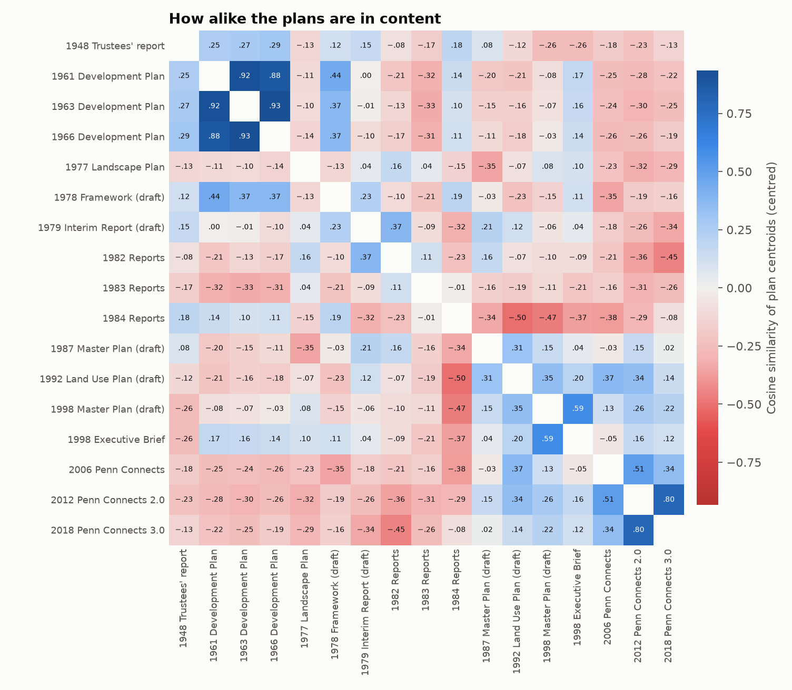
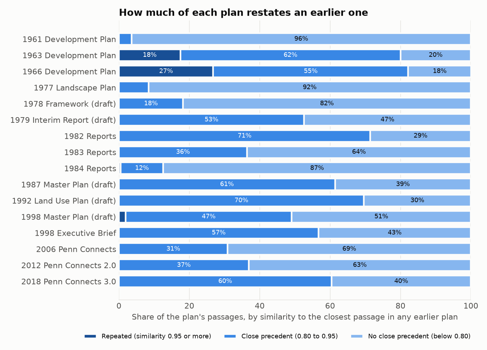
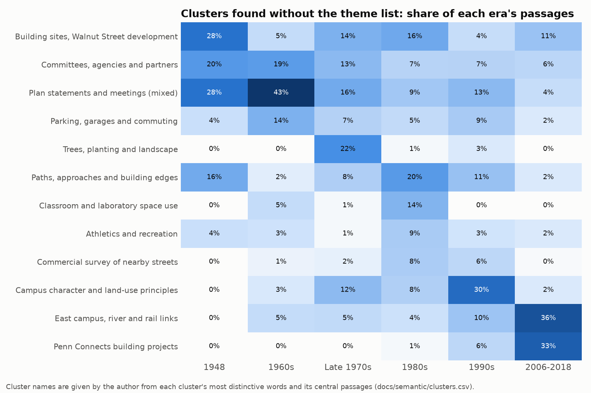
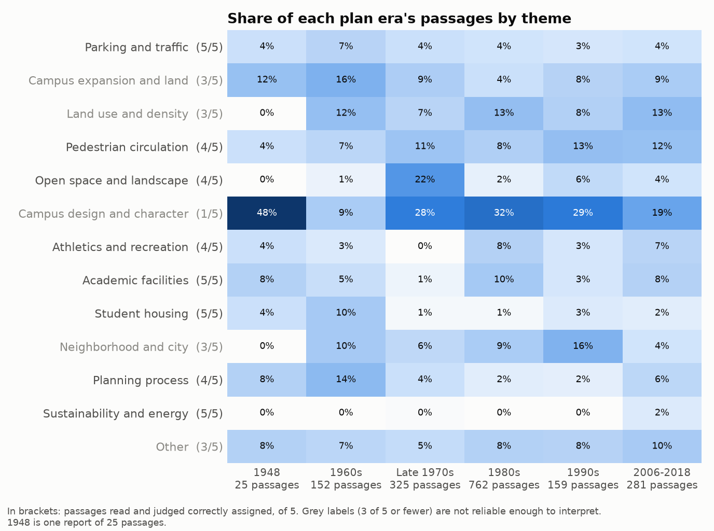
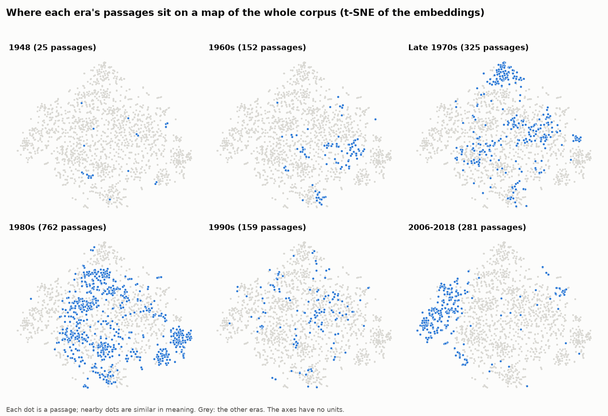

# Semantic analysis of Penn's campus plans, 1948 to 2018 (Vision 1.5)

Status on 2026-11-22. Code in `penn_semantic/`, tables and figures in
`docs/semantic/`.

**Short version.** Transformer embeddings of 1,704 passages from 17 plans show
three things. First, the plans form lineages: the 1961, 1963 and 1966
Development Plans are one plan revised twice, Penn Connects 2.0 and 3.0 are
close to each other, and the 1992 Land Use Plan is the nearest earlier plan to
Penn Connects (2006). Second, the subject matter shifts by period: governance
and plan statements in 1948 and the 1960s, landscape in the late 1970s,
building-by-building studies in the 1980s, campus character in the 1990s, and
the eastern riverfront and building projects from 2006. Third, parking takes a
small and steady share of every era, while pedestrian circulation roughly
doubles its share from the late 1970s on. Every period except the 1960s is
dominated by one or two documents, so these are findings about the plans in
this archive, not about Penn's planning as a whole.

## 1. Data and method

| Step | What was done |
|---|---|
| Units | 1,704 passages of about 1,000 characters: the prose passages of the retrieval index (Part 2), tables left out, second scans of the 1961, 1963 and 1966 plans left out |
| Embedding | `BAAI/bge-base-en-v1.5` through sentence-transformers, 768 dimensions, normalised; the same model as retrieval |
| Periods | 1948 (25 passages), 1960s (152), late 1970s (325), 1980s (762), 1990s (159), 2006 to 2018 (281). The archive has no plans for 1949 to 1960 or 1967 to 1976 |
| Measure | Shares of each period's or plan's passages, never counts, because plans range from 25 to 236 passages |

Four analyses, each meant to check the others:

1. **Themes**: each passage is scored against short descriptions of 12
   planning themes (the seven Vision 1.5 names, plus student housing,
   planning process, athletics, academic facilities, sustainability) and
   assigned to the best one if its score is at least 0.60; otherwise "Other".
2. **Clusters**: k-means (k = 12) on the embeddings, with no theme list.
   Each cluster is described by its most distinctive words (class-based
   TF-IDF) and its central passages, and named by the author from those.
3. **Plan similarity**: each plan's mean vector, compared by cosine after the
   corpus mean is subtracted. (Without that step every pair of plans scores
   between 0.90 and 0.99, which says more about the embedding space than the
   plans.)
4. **Carried-over text**: for every passage, its most similar passage in any
   earlier plan. 0.95 or above is a repeat; below 0.80 has no close precedent.

### How far the themes can be trusted

After a first reading showed that passages about building siting and the field
house were being filed under open space, two themes were added and a score
floor set. Then five new passages per theme were drawn at random and read
(`annotation/semantic_theme_check.json`):

| Theme | Correct of 5 | Use |
|---|---|---|
| Parking and traffic, Academic facilities, Student housing, Sustainability and energy | 5 | interpreted |
| Pedestrian circulation, Open space and landscape, Athletics and recreation, Planning process | 4 | interpreted |
| Campus expansion and land, Land use and density, Neighborhood and city | 3 | shown, not interpreted |
| Campus design and character | 1 | shown, not interpreted: it has become the catch-all, and is the largest theme |

Overall 46 of 60 (77 %). The clusters do not depend on the theme list, so a
finding is stated below only when the clusters and a reliable theme agree, or
when it rests on the clusters alone and the cluster's passages were read.

## 2. Findings

### 2.1 The plans form lineages





- **1961, 1963 and 1966 are one plan.** Their mean vectors are 0.88 to 0.93
  apart, far above any other pair. 18 % of the 1963 plan's passages are near
  repeats of 1961 and another 62 % have a close precedent; for 1966 it is 27 %
  and 55 %, mostly from 1963. The 1978 Framework, a consultant's draft, is the
  plan closest to them (0.37 to 0.44).
- **Later plans rewrite rather than repeat.** No plan after 1966 repeats more
  than 2 % of its passages from an earlier one. Where they draw on earlier
  plans, it is by paraphrase: 53 to 71 % of the passages in the 1979 Interim
  Report, the 1982 Reports, the 1987 Master Plan, the 1992 Land Use Plan and
  Penn Connects 3.0 have a close precedent.
- **Two lines of descent.** The 1979 Interim Report and the 1982 Reports are
  each other's nearest plans (0.37). The 1992 Land Use Plan is the earlier plan
  closest to Penn Connects (2006) (0.37), and to the 1998 Master Plan (0.35);
  Penn Connects 2.0 and 3.0 are close (0.80), with 2006 a step further back.
- **Outliers.** The 1977 Landscape Development Plan (92 % of its passages have
  no close precedent) and the 1984 Reports (87 %) stand apart from every other
  plan. Both are specialised studies: a landscape inventory, and a space-use
  study of the engineering school.

### 2.2 What the plans talk about, by period





| Period | What dominates (clusters) | Agrees with themes |
|---|---|---|
| 1948 | Committees, agencies and meetings; where to site buildings | Planning process 8 % (one report of 25 passages) |
| 1960s | Plan statements and their institutional actors (43 % and 19 % of passages); parking and commuting at its highest (14 %) | Planning process 14 %, student housing 10 %, both their highest |
| Late 1970s | Trees, planting and landscape (22 %) | Open space and landscape 22 %; almost all from the 1977 Landscape Plan (44 % of that plan) |
| 1980s | Building edges and paths (20 %), classroom and laboratory space use (14 %), building sites (16 %) | Academic facilities 32 % of the 1984 Reports, athletics 21 % of the 1983 Reports, parking 14 % of the 1982 Reports |
| 1990s | Campus character and land-use principles (30 %) | Not checked: its theme (campus design) is unreliable |
| 2006-2018 | The east campus, river and rail links (36 %), building projects (33 %) | Sustainability appears for the first time (2 %); academic facilities 25 % of Penn Connects 3.0 |

Read as a sequence, the archive moves from plans as statements of institutional
intent (1948, 1960s), through specialised studies of one system at a time
(landscape in 1977; parking, athletics and laboratory space in the 1982 to 1984
reports), to plans about the character of the campus as a place (1992), and then
to a plan for a new territory, the land east of campus along the Schuylkill
(Penn Connects). The late 1970s and 1980s rows are each shaped by one or two
documents: they describe what those studies took up, which is itself the
pattern.

### 2.3 Two of the Vision's questions

**Parking.** The share of passages about parking and traffic (theme checked 5
of 5) stays between 3 and 7 % in every period, and between 0 and 14 % in every
plan. The highest single plans are the 1982 Reports (14 %, which include a
parking study) and the 1963 Development Plan (10 %). The clusters agree: the
parking and commuting cluster peaks in the 1960s at 14 %. Parking was a
standing concern of every plan, not the subject of a particular period. These
shares say how much a plan discusses parking, not what it proposes; the
change in position is a question for the chatbot or for reading (see
`docs/rag_report.md`, where an 8B model answered it poorly).

**Pedestrian environments.** The pedestrian circulation share (checked 4 of 5)
is 4 to 7 % in 1948 and the 1960s and 10 to 17 % in most plans from 1977 on
(1977, 1979, 1982, 1983, 1992, 1998 Executive Brief, 2006, 2012). The 1960s
plans already propose a pedestrian campus (closing Locust Street), so the idea
is older than its prominence: what changes from the late 1970s is how much of
each plan is given to it.

### 2.4 The map



On a t-SNE map of all passages, the 1960s and 2006 to 2018 passages each
occupy their own regions, the late 1970s concentrate in one corner (the
landscape inventory), and the 1980s spread widest: they cover the most
subjects. The map shows neighbourhoods, not distances; the plan similarity
above is the measured version.

## 3. Is the result sensitive to OCR errors?

The 92 benchmark paragraphs exist as typed by a person and as read by the OCR
model used for the corpus (`python -m penn_semantic.sensitivity`).

| Measure | Result |
|---|---|
| Cosine between the typed and OCR version of a paragraph | mean 0.996, lowest 0.928 |
| Cosine between two different paragraphs | mean 0.543, highest 0.769 |
| OCR version's nearest typed paragraph is its own | 92 of 92 |
| Same theme for both versions | 90 of 92 |

One of the two theme changes is the 1977 paragraph that lost a sentence to a
missed line (CER 9 %); the other is a paragraph that sits on the boundary of
two themes (CER 0.5 %). At this corpus's error rate, OCR does not change the
semantic results; the one error that matters, a lost line, matters here too.

## 4. Limitations

- **Periods are documents.** The late 1970s are mostly one landscape plan,
  the 1980s are mostly three annual reports that each studied one subject,
  and 1948 is one report of 25 passages. A change between periods can be a
  change between document types.
- **Shares measure attention, not position.** A plan that argues against
  more parking and one that asks for it both count toward parking.
- **The theme check is small and one reader's.** Five passages per theme,
  read by the author. Four themes did not pass and are not interpreted,
  including the largest.
- **Passages mix subjects.** A 1,000-character passage often covers two
  topics, and gets one theme.
- **One embedding model, one k.** The results were not repeated with a
  second sentence model, and k = 12 was chosen for readability, not
  optimised. Cluster names are the author's.
- **Tables are left out**, so the figures in the plans (parking counts,
  floor areas) are not part of this analysis.
- **Drafts and published plans are mixed** within periods; the status of each
  plan is in its label.

## 5. Reproducing

```
python -m penn_semantic.embed          # 1,704 passages -> work/semantic/vectors.npy (about 2 min on CPU)
python -m penn_semantic.analyze        # themes, clusters, similarity, carried-over text -> docs/semantic/*.csv
python -m penn_semantic.figures        # docs/semantic/*.png
python -m penn_semantic.sensitivity    # typed vs OCR text of the 92 benchmark paragraphs
```

Requires the corpus and passages from Parts 1 and 2 (`penn_ocr.corpus`,
`penn_rag.passages`). Versions: sentence-transformers 6.3.0, scikit-learn
1.9.1, matplotlib 3.11.2; random seed 20261122.
